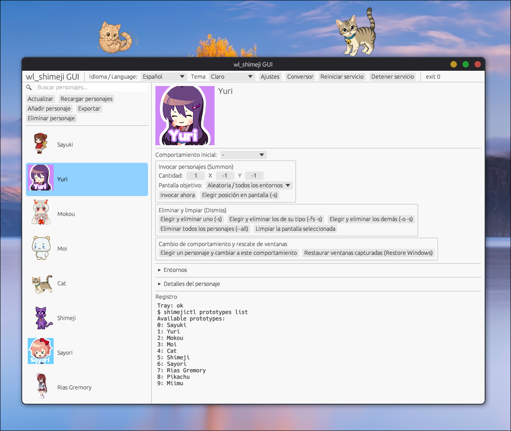

# shimeji-gui-rs

GUI de escritorio en Rust para gestionar personajes de [wl_shimeji](https://github.com/CluelessCatBurger/wl_shimeji) mediante `shimejictl`.  
Construida con `eframe/egui`, orientada a Linux Wayland/KDE Plasma.



## Funciones

### Personajes
- Lista de prototipos con búsqueda, miniatura y vista previa.
- **Invocar (Summon)**: cantidad, posición X/Y, comportamiento inicial y entorno destino.
- **Descartar (Dismiss)**: un personaje, mismo tipo, otros, pantalla actual o todos (con confirmación).
- **Comportamiento y rescate**: cambiar comportamiento del personaje seleccionado y restaurar ventanas.
- **Gestión**: agregar/importar `.wlshm`, exportar personaje a `.zip` (selección de carpeta destino), eliminar personaje (con confirmación).

### Conversor
- Detecta el esquema de entrada: Shimeji original con **XML japonés** (`動作リスト`/`行動リスト`), instancia **Shimeji-EE** (`conf/` + `img/`) o bundle (`manifest.json` + `animation.json` + `sprites/*.webp`), en ZIP o directorio.
- El XML japonés se traduce en Rust con la tabla de `shimeji-jap-to-wlshm.py` y se prepara como instancia EE de un prototipo para `shimejictl convert`. Usa el campo **Nombre del prototipo** cuando haya que elegir `img/<name>`; si no, se deduce del nombre del ZIP/directorio.
- Los bundles se convierten en Rust reutilizando la lógica de un prototipo base (`--base`/prototipo base) y redimensionando sus 46 sprites a 128×128 en QOI. Si la base configurada no está instalada, se usa el primer prototipo **compatible** (lógica que referencia exactamente `shime1.qoi`…`shime46.qoi`) con un aviso; los sprites mapeados que falten en bundles cortos se sustituyen por el sprite existente más cercano.
- Las instancias Shimeji-EE se delegan a `shimejictl convert`.
- Correcciones integradas, idempotentes y seleccionables (`--fixes`): `refs` (verifica las referencias de sprites y restaura una lógica compatible), `scale` (altura objetivo configurable), `anchor`, `fall`, `embedded` y `cover`; se pueden desactivar con **Sin correcciones**.
- **Solo corregir (.wlshm)** aplica las correcciones a un paquete ya convertido sin reconvertirlo.
- Las conversiones fallidas de `shimejictl` se detectan aunque devuelva código 0: se descartan los `.wlshm` vacíos o inválidos y se informa del error en vez de importarlos.
- Permite elegir directorio de salida (o un archivo `.wlshm` como destino) e importar el resultado al finalizar.

### Entornos / Inspector
- Visualiza entornos detectados y sus datos (ID, nombre, tamaño, mascotas).
- Permite seleccionar entorno objetivo para acciones.

### Ajustes
- **Idioma**: Español / English.
- **Tema**: Claro / Oscuro (se guarda y se carga al iniciar).
- Configuración de sesión/plugins e interacción con ventanas (IE mode), según soporte de `wl_shimeji`.
- Autostart y opciones de servicio.

### Sistema
- Icono de bandeja con acciones rápidas.
- Cerrar la ventana con la «X» (o Alt+F4) cierra de verdad el proceso de la GUI, así que su icono desaparece del dock/taskbar; el proceso anfitrión de la bandeja sigue vivo.
- **Mostrar / Ajustes** en la bandeja vuelve a lanzar la ventana; **Salir/Quit** termina la aplicación.
- Funciona con cualquier compositor (Wayland o X11): no depende de atajos propietarios ni de ventanas minimizadas.
- Registro/log de salida de comandos.
- Diálogos de archivo con soporte nativo en KDE (`kdialog`/`zenity`) y fallback.

## Requisitos

- Linux (probado para Wayland/KDE Plasma).
- `shimejictl` disponible en `PATH`.
- Rust estable para compilar (`edition 2024`).

## Compilar y ejecutar

```bash
cargo build --release
cargo run
```

Binario de release:

```bash
./target/release/shimeji-gui-rs
```

## Compatibilidad

La app mantiene compatibilidad con rutas y formatos existentes de `wl_shimeji`:

- `~/.config/wl_shimeji`
- `~/.local/share/wl_shimeji/shimeji-overlayd.conf`
- Archivos `*-support.conf`
- `ie_mode`, autostart/desktop, `shimejictl`, paquetes `.wlshm`
