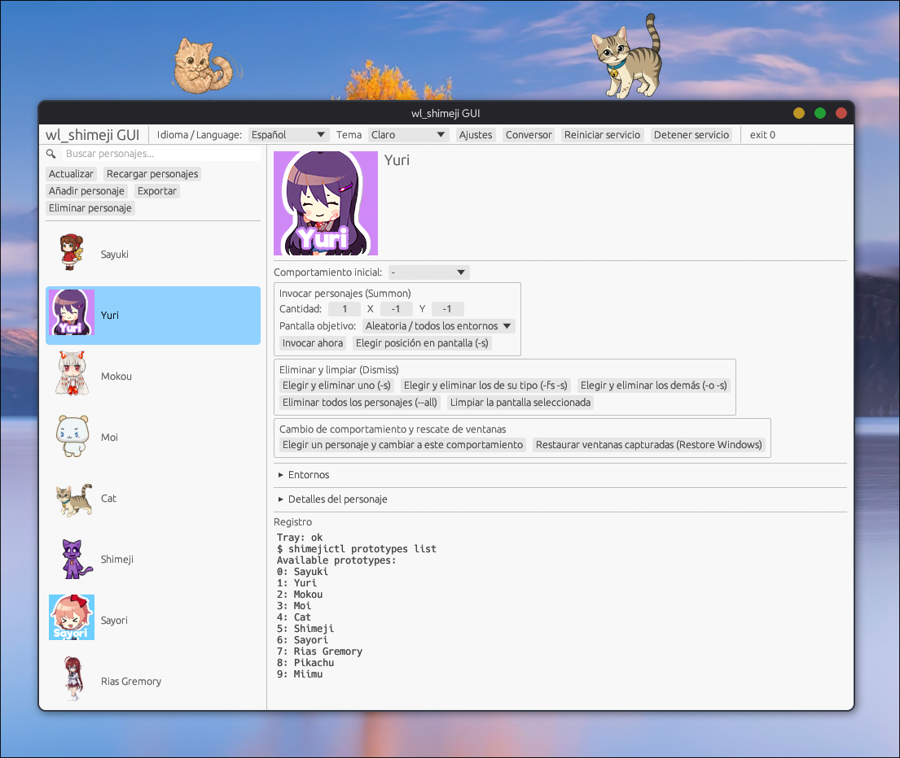

# shimeji-gui-rs

Desktop GUI written in Rust for managing [wl_shimeji](https://github.com/CluelessCatBurger/wl_shimeji) characters via `shimejictl`.  
Built with `eframe/egui`, targeted at Linux Wayland/KDE Plasma.



## Features

### Characters
- Prototype list with search, thumbnail, and preview.
- **Summon**: count, X/Y position, initial behavior, and target environment.
- **Dismiss**: a character, the same type, others, the current screen, or all (with confirmation).
- **Behavior and rescue**: change the behavior of the selected character and restore windows.
- **Management**: add/import `.wlshm` files, export a character to `.zip` (choose the destination folder), delete a character (with confirmation).

### Converter
- Converts packages from **ZIP** or **directory** to the `.wlshm` format.
- Lets you choose the output directory.
- Option to import the converted package when finished.

### Environments / Inspector
- Displays detected environments and their data (ID, name, size, pets).
- Allows selecting the target environment for actions.

### Settings
- **Language**: Español / English.
- **Theme**: Light / Dark (saved and restored on startup).
- Session/plugin configuration and window interaction (IE mode), depending on `wl_shimeji` support.
- Autostart and service options.

### System
- Tray icon with quick actions.
- Closing the window with the "X" (or Alt+F4) actually terminates the GUI process, so its icon disappears from the dock/taskbar; the tray host process stays alive.
- **Show / Settings** in the tray relaunches the window; **Exit/Quit** terminates the application.
- Works with any compositor (Wayland or X11): it does not rely on proprietary shortcuts or minimized windows.
- Log of command output.
- File dialogs with native support on KDE (`kdialog`/`zenity`) and a fallback.

## Requirements

- Linux (tested on Wayland/KDE Plasma).
- `shimejictl` available in `PATH`.
- Stable Rust to build (`edition 2024`).

## Build and run

```bash
cargo build --release
cargo run
```

Release binary:

```bash
./target/release/shimeji-gui-rs
```

## Compatibility

The app maintains compatibility with existing `wl_shimeji` paths and formats:

- `~/.config/wl_shimeji`
- `~/.local/share/wl_shimeji/shimeji-overlayd.conf`
- `*-support.conf` files
- `ie_mode`, autostart/desktop, `shimejictl`, `.wlshm` packages
